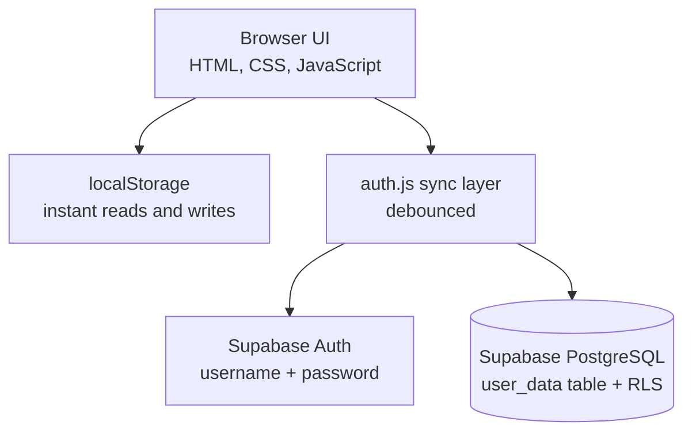

# Attendance Tracker

[](https://saptaattendancetracker.vercel.app/)
[](https://vercel.com/)
[](https://supabase.com/)
[](#progressive-web-app)
[](#getting-started)

A lightweight, cloud-synced web app for tracking class attendance. Students set up their subjects and weekly timetable, record each class as present, absent or cancelled, and see in real time how they stand against their attendance target, including how many classes they can still afford to miss.

<p align="center">
  <a href="https://saptaattendancetracker.vercel.app/"><b>🚀 Live App</b></a> &nbsp;·&nbsp;
  <a href="https://drive.google.com/file/d/14hmNhFu6fX0dbP1fYa7jXKglhvn2g_rF/view?usp=drive_link"><b>🎬 Demo Video</b></a> &nbsp;·&nbsp;
  <a href="#features"><b>✨ Features</b></a> &nbsp;·&nbsp;
  <a href="#getting-started"><b>🛠️ Get Started</b></a>
</p>

**Live application:** <https://saptaattendancetracker.vercel.app/>  
**Demo video:** https://drive.google.com/file/d/14hmNhFu6fX0dbP1fYa7jXKglhvn2g_rF/view?usp=drive_link

<!--
Add screenshots to docs/screenshots/ and uncomment:

<p align="center">
  
  
  
</p>
-->

---

## Table of Contents

1. [Overview](#overview)
2. [Features](#features)
3. [Attendance Calculation](#attendance-calculation)
4. [Attendance Planner](#attendance-planner)
5. [AI Assistant](#ai-assistant)
6. [Technology Stack](#technology-stack)
7. [Architecture](#architecture)
8. [Project Structure](#project-structure)
9. [Getting Started](#getting-started)
10. [Deployment](#deployment)
11. [Usage Guide](#usage-guide)
12. [Security](#security)
13. [Known Limitations](#known-limitations)
14. [Roadmap](#roadmap)
15. [Contributing](#contributing)
16. [License](#license)

---

## Overview

Most institutions require a minimum attendance percentage, yet students rarely have an accurate, up-to-date picture of where they stand. Attendance Tracker provides:

- A per-subject and overall view of attendance against a configurable target.
- Forward-looking guidance: classes that can safely be skipped, or must be attended, to stay at target.
- A planner that shows the effect of a break or holiday before it is taken.
- A local-first experience that feels instant, with automatic cloud sync across devices.

The app is a static site with no build step. Authentication and storage are handled by Supabase.

---

## Features

| Area | Description |
|---|---|
| **Dashboard** | Overall percentage, present / absent / total counts, editable target (default 75%), today's schedule, today's holidays and an attendance streak. |
| **Subjects** | Create, edit and delete subjects; assign each to weekdays to build a weekly timetable. Each subject card shows a risk badge with advice. |
| **Calendar** | Monthly view with colour-coded present, absent, partial and cancelled days, plus holidays and Sundays. Selecting a date opens its attendance page. |
| **Attendance marking** | Per-subject **Present**, **Absent**, **Cancelled** and **Remove Marking**, plus a **Cancel all classes** shortcut for a day. |
| **Reports** | Per-subject percentages with progress indicators, and weekly and monthly trend charts. |
| **Holidays** | Bundled official holidays for 2026 to 2030, custom holidays, several holidays on the same date, and automatic Sunday handling. |
| **Planner** | Holiday-aware bunk planner and a what-if simulator. See [Attendance Planner](#attendance-planner). |
| **AI Assistant** | In-browser assistant that answers questions about your own attendance. See [AI Assistant](#ai-assistant). |
| **Profile photo** | Upload and crop a photo; it is stored with your account and shown on every device. |
| **Themes** | Blue, green, purple and dark themes, chosen in Settings and remembered across every page. |
| **Data export** | Download your data as CSV or a full JSON backup. |
| **Notifications** | Optional browser reminders. |
| **Cloud sync** | One account, available on every device. |
| **Progressive Web App** | Installable on mobile and desktop. |

### Risk badges

Each subject is rated against your target `T`:

| Badge | Condition |
|---|---|
| 🟢 Safe | percentage ≥ `T` + 5 |
| 🟡 Careful | `T` ≤ percentage < `T` + 5 |
| 🔴 Danger | percentage < `T` |
| ⚪ No data | no counted classes yet |

Each card also explains what to do, for example *"You can skip 3 more classes"* or *"Attend the next 4 classes in a row to reach 75%"*.

---

## Attendance Calculation

Every class is recorded with one of three statuses:

| Status | Counted in percentage |
|---|---|
| `present` | Yes (numerator and denominator) |
| `absent` | Yes (denominator only) |
| `cancelled` | No |

```text
Attendance % = Present / (Present + Absent) x 100
```

Cancelled classes are stored so the calendar and history stay accurate, but they are excluded from every calculation because the class did not take place.

**Classes that can still be missed** while staying at or above target `T`, with `P` present and `N` counted classes:

```text
max_skippable = floor( (P x 100) / T - N )
```

**Consecutive classes required** to reach target `T` when currently below it:

```text
required = ceil( (T x N - 100 x P) / (100 - T) )
```

---

## Attendance Planner

The planner (`planner.html`) answers the question *"what happens to my attendance if I take this break?"*

**Bunk planner**

1. Pick a start and end date.
2. Sundays and your holidays (official and custom) are skipped automatically, and classes you have already marked are not counted twice.
3. For each subject, a slider sets how many of the remaining classes you would skip.
4. The page shows your current percentage, the projected percentage and a risk badge. *Skip all* and *Attend all* buttons set every slider at once.

**What-if simulator**

Two sliders per subject (*attend X more*, *skip Y more*) with the result updating live. Nothing is saved.

The planner assumes every scheduled class takes place, and only lists subjects that have days assigned on the Subjects page.

---

## AI Assistant

The assistant is available from the chat button on every page. It runs entirely in the browser: no external API, no API key, and no attendance data leaves your device for processing.

**Capabilities**

- Tolerates spelling mistakes and informal phrasing ("bunk" is understood as "skip").
- Recognises subject names, abbreviations and initials.
- Resolves relative dates such as *today*, *tomorrow* and weekday names.
- Remembers context, so follow-ups like "what about physics?" work.

**Example queries**

| Query | Result |
|---|---|
| How am I doing? | Overall status, safe-to-skip count, subjects below target |
| Can I skip maths tomorrow? | Projected effect of missing that day's classes |
| How many classes do I need to reach 85%? | Consecutive classes required |
| Which subjects are at risk? | Subjects below target or with no margin |
| What classes do I have tomorrow? | Scheduled subjects and their status |
| Am I improving? | Last 7 days compared with the 7 before |
| Set my target to 80% | Updates the attendance target |

---

## Technology Stack

| Layer | Technology |
|---|---|
| Frontend | HTML5, CSS3, vanilla JavaScript (no framework, no bundler) |
| Authentication and database | [Supabase](https://supabase.com/) Auth and PostgreSQL with Row Level Security |
| Charts | [Chart.js](https://www.chartjs.org/) |
| Hosting | [Vercel](https://vercel.com/) (static) |
| Offline and install | Service Worker and Web App Manifest |

---

## Architecture



- **Local first.** All reads and writes hit `localStorage`, so the UI is instant.
- **Sync.** Changes to a synced key are debounced and upserted to Supabase; the latest data is pulled when you return to the app.
- **Synced keys:** `subjects`, `attendanceRecords`, `holidays`, `attendanceTarget`, `weeklySchedule`. The profile photo is stored in its own `profile_pic` column so normal data saves cannot overwrite it.
- **Authentication.** Users sign in with a username and password; internally the username maps to `<username>@attendance.com` for Supabase Auth.

**Attendance record format**

```json
{ "date": "2026-10-05", "subjectId": "1791225003729", "status": "present" }
```

---

## Project Structure

The application lives in the `sapta-attendance-tracker/` folder of this repository.

```text
sapta_attendance_tracker/
|-- README.md
'-- sapta-attendance-tracker/
    |-- index.html              Dashboard
    |-- subjects.html           Subjects and weekly timetable
    |-- calendar.html           Monthly calendar
    |-- attendance.html         Mark attendance for a date
    |-- report.html             Reports and charts
    |-- holidays.html           Official and custom holidays
    |-- planner.html            Bunk planner and what-if simulator
    |-- login.html              Sign in
    |-- signup.html             Account creation
    |-- manifest.json           PWA manifest
    |-- SUPABASE_SETUP.sql      Database schema and security policies
    |-- icon-192.png
    |-- icon-512.png
    |-- css/
    |   '-- style.css           Styles, themes and dark mode
    '-- js/
        |-- app.js              Dashboard logic, target, shared data accessors
        |-- attendance.js       Marking, statistics, cancel-all
        |-- subjects.js         Subjects and weekly schedule
        |-- calendar.js         Calendar rendering
        |-- holidays.js         Holiday data (2026-2030) and management
        |-- report.js           Reports
        |-- insights.js         Risk badges and planner calculations
        |-- planner.js          Planner and what-if simulator
        |-- profile.js          Profile photo: crop and cloud sync
        |-- theme.js            Remembers dark/light mode and colour theme
        |-- ai_assistant.js     Assistant, theme switcher, export, notifications
        |-- auth.js             Authentication and cloud synchronisation
        |-- login.js            Sign-in form handling
        |-- supabase.js         Supabase client configuration
        '-- service_worker.js   Offline caching
```

---

## Getting Started

### Prerequisites

- A free [Supabase](https://supabase.com/) project
- Any static file server (Python, Node.js or the VS Code Live Server extension)

### 1. Get the source

```bash
git clone https://github.com/SaptaparnaDas-04/sapta_attendance_tracker.git
cd sapta_attendance_tracker/sapta-attendance-tracker
```

### 2. Configure Supabase

1. Create a Supabase project.
2. In **SQL Editor**, run [`SUPABASE_SETUP.sql`](./sapta-attendance-tracker/SUPABASE_SETUP.sql) once. It creates the `user_data` table and its Row Level Security policies.
3. If you created the table before profile photos were added, also run:

   ```sql
   alter table public.user_data add column if not exists profile_pic text;
   ```

4. In **Authentication > Providers > Email**, turn **Confirm email** off. Usernames map to placeholder addresses that cannot receive mail.
5. In **Project Settings > API**, copy the project URL and the **anon public** key into `js/supabase.js`:

   ```js
   const SUPABASE_URL = "https://<your-project>.supabase.co";
   const SUPABASE_KEY = "<your-anon-public-key>";
   ```

### 3. Run locally

```bash
# Python
python -m http.server 5501

# Node.js
npx serve .
```

Open `http://localhost:5501/login.html`.

---

## Deployment

The app is a static site and deploys to Vercel without a build step.

1. Push the repository to GitHub.
2. Import it in Vercel.
3. Set **Root Directory** to `sapta-attendance-tracker`.
4. Set **Framework Preset** to *Other*, and leave the build command and output directory empty.
5. Deploy.

Any static host (Netlify, GitHub Pages, Cloudflare Pages) works too.

---

## Usage Guide

1. **Create an account** on the sign-up page.
2. **Add subjects** and choose the weekdays each one is held on.
3. **Review holidays.** Official holidays are preloaded; add custom ones if needed.
4. **Record attendance** from the calendar. Use *Cancelled* when a class does not take place.
5. **Check your status** on the dashboard and reports, or ask the assistant.
6. **Plan ahead** with the Planner before taking a break.
7. **Personalise** your theme, profile photo, export and notifications from Settings and the navbar avatar.

---

## Security

- Access is restricted by PostgreSQL **Row Level Security**: each user can select, insert and update only their own `user_data` row.
- The Supabase **anon** key in client code is designed to be public. Never put the `service_role` key in this project.
- The assistant processes data locally; no attendance data is sent to a third party.
- If a legacy `users` table with plain-text passwords exists from an earlier version, drop it once the current setup is verified.

---

## Known Limitations

- **No password recovery.** Accounts use placeholder email addresses, so there is no reset-by-email flow.
- **Service worker path.** `app.js` registers `/service_worker.js`, while the file is at `/js/service_worker.js`. Offline mode and installation may be affected until the path is corrected.
- **Incomplete offline cache.** The cache list does not yet include every script (for example `ai_assistant.js`, `supabase.js` and the newer planner, profile and theme files).
- **Concurrent edits.** Sync is last-write-wins; simultaneous edits on two devices can overwrite each other.
- **Holiday coverage.** Official holidays are bundled for 2026 to 2030; other years use fixed national holidays plus estimated dates.

---

## Roadmap

- [ ] Correct the service worker path and cache list for full offline support
- [ ] Email-based accounts and password recovery
- [ ] Per-subject attendance targets
- [ ] Class timings with a next-class countdown and per-class reminders
- [ ] Daily "today's classes" notification
- [ ] Import from a JSON backup
- [ ] Multi-semester support
- [ ] Shareable attendance report card
- [ ] Optional LLM-backed assistant via a serverless function

---

## Contributing

Contributions are welcome.

1. Fork the repository and create a feature branch.
2. Make your changes. There is no build step, so edit the files and refresh the browser.
3. Check the affected pages manually, including dark mode and a mobile viewport.
4. Open a pull request describing the change and why it is needed.

---

## License

No license has been specified yet. Add a `LICENSE` file (for example, MIT) before distributing the project or accepting outside contributions.

---

## Author

Built by [SaptaparnaDas-04](https://github.com/SaptaparnaDas-04).

If you find this project useful, consider giving the repository a star.
